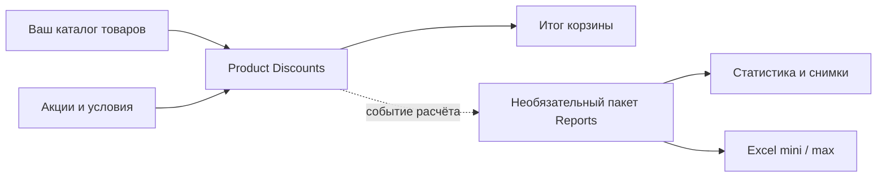

# Laravel Product Discounts

**Акции для товаров. Ваш каталог. Ваши правила.**

Движок расчёта и готовая админка для Laravel. Статистика подключается отдельным
пакетом — основной расчёт не требует хранения истории и библиотек Excel.

[Установка](#установка-из-локальной-папки) · [Админка](#админка) · [API](#api) ·
[Дополнение со статистикой](https://github.com/Ilia-Xorosh/laravel-product-discounts-reports)

## Что внутри

| Задача | Возможности |
| --- | --- |
| Изменить цену | Скидка, наценка, фиксированная цена — на товар или корзину |
| Задать условие | Бренд, товар, категория, количество, сумма, промокод |
| Управлять акциями | Сроки, приоритеты, порядок и исключение следующих акций |
| Подключить каталог | Eloquent или собственные адаптеры расчёта и поиска |
| Работать в админке | Динамические формы, поиск, дерево категорий |
| Проверить расчёты | Целые копейки/центы, общий лимит скидки, согласованные итоги |



### Пример

Два товара по 100,00, промокод на 10%: исходная сумма **200,00**, скидка
**20,00**, итог **180,00**. В API это соответственно `20000`, `2000` и `18000`.
Цена и остаток берутся из вашего каталога, а не из запроса покупателя.

Локальная проверка: **27 PHP-тестов и 4 JS-теста**. Совместная работа с дополнением
проверяется отдельными 8 интеграционными тестами. Эти результаты не заменяют статус CI.

## О пакете

Самостоятельный пакет акций для **товаров**: скидки, наценки, фиксированные цены,
промокоды, условия по бренду, товару, категории, количеству и сумме.
Включает API-контроллер, админку на Blade, модели, миграции и тесты.
Внешние API и платные библиотеки не требуются. Лицензия MIT.

Требования: PHP 8.2+, Laravel 11 или 12. Тестовое окружение использует Laravel 12;
для Laravel 11 совместимость объявлена по API, отдельный прогон пока не выполнен.
GitHub и Packagist ещё не опубликованы; имя Composer предварительное.

## Установка из локальной папки

Добавьте в `composer.json` **приложения**:

```json
{
    "repositories": [
        {"type": "path", "url": "packages/laravel-product-discounts"}
    ]
}
```

Затем в приложении:

```bash
composer require product-discounts/laravel-product-discounts:@dev
php artisan vendor:publish --tag=product-discounts-config
php artisan vendor:publish --tag=product-discounts-migrations
php artisan migrate
```

ServiceProvider подключается через Laravel package discovery.
Создаются только таблицы `product_discount_actions`, `product_discount_doings`
и `product_discount_action_doing`. Таблицы приложения не изменяются.
Миграции публикуются явно, автоматически при загрузке пакета не запускаются.

После публикации GitHub-репозитория можно заменить `path` на `vcs` с его URL.
После регистрации в Packagist и выпуска стабильного тега установка будет через
`composer require product-discounts/laravel-product-discounts:^1.0`.
Сейчас эта команда для Packagist ещё не доступна.

## Источник товаров

Все денежные значения — **целые копейки/центы**, включая цену товара, сумму
условия, размер денежного изменения и значения ответа. Например, 10000 = 100,00.
Входящая цена клиента не используется. Каталог обязан возвращать только товары,
доступные текущему магазину/клиенту; ограничения доступа и актуальность цен
обеспечивает приложение.

Для стандартной Eloquent-модели настройте `config/product-discounts.php`:

```php
'product_model' => App\Models\Product::class,
'columns' => [
    'id' => 'id', 'name' => 'name', 'price' => 'price_in_cents',
    'stock' => 'stock', 'brand' => 'brand_id',
],
'categories_relation' => 'categories', // либо null
```

Категории возвращаются через указанную Eloquent-связь; используются их ключи.
Для API, другого формата данных, десятичных цен или составного каталога
реализуйте контракт:

```php
namespace App\Discounts;

use ProductDiscounts\Contracts\ProductCatalog;
use ProductDiscounts\Data\Product;

final class Catalog implements ProductCatalog
{
    public function find(array $ids): array
    {
        // Загрузите запрошенные товары из своего каталога.
        // Все ID, включая бренды и категории, передавайте строками.
        return [
            'sku-1' => new Product(
                id: 'sku-1', name: 'Товар', price: 10000, stock: 20,
                brandId: 'brand-1', categoryIds: ['category-1'],
            ),
        ];
    }
}
```

Укажите `'catalog' => App\Discounts\Catalog::class` в конфигурации.
Демонстрационный метод выше замените реальной загрузкой запрошенных ID.
Если исходный каталог хранит рубли, переводите цены в копейки в адаптере,
с явным правилом округления.

## Админка

В конфигурации установите `admin.enabled` в `true`. По умолчанию используются
middleware `web`, `auth`, `can:manage-product-discounts`. Определите Gate в
своём приложении, например:

```php
use Illuminate\Support\Facades\Gate;

Gate::define('manage-product-discounts', fn ($user) => $user->is_admin === true);
```

Замените проверку на принятую в приложении систему ролей.
Адрес: `/admin/product-discounts/actions`.
Сначала создайте действие, затем акцию, выберите её действия и сроки активности.
Формы работают самостоятельно, без Bootstrap, jQuery и внешних CDN.
Форма динамически показывает нужные поля и допустимые сравнения.
Доступны поиск товаров, выбор бренда по букве, переходы по дереву категорий
и поиск товаров в выбранном разделе. Сохранённый ID сохраняется при открытии
редактирования; при выборе другого типа сущности старый ID очищается.
ID можно также ввести вручную. JavaScript встроен в Blade и не требует сборки.

Для поиска настройте модели брендов и категорий:

```php
'browser_models' => [
    'brands' => ['model' => App\Models\Brand::class, 'id' => 'id', 'name' => 'name'],
    'categories' => [
        'model' => App\Models\Category::class, 'id' => 'id', 'name' => 'name', 'parent' => 'parent_id',
    ],
],  
```

Встроенный адаптер использует `product_model` и `columns` для товаров,
`categories_relation` для фильтрации товаров по категории. Корневые категории
имеют `NULL` в поле родителя. Поиск выполняется по названию или точному ID;
одна буква в поиске брендов означает начало названия. Ответ ограничен 50 записями.
Пустые результаты и ошибки загрузки отображаются прямо в форме.

Для другого каталога реализуйте `ProductDiscounts\Contracts\CatalogBrowser`
и укажите класс в параметре `browser`:

```php
public function search(string $kind, string $query, ?string $parentId): array
{
    // $kind: products, brands, categories.
    // $parentId: родитель категории либо категория-фильтр товаров.
    // null означает корень категорий либо товары без фильтра категории.
    // Верните до 50 доступных текущему пользователю записей:
    return [['id' => '123', 'name' => 'Название']];
}
```

Маршрут поиска `GET /admin/product-discounts/catalog` использует те же права,
что и админка. Префикс берётся из конфигурации. Адаптер должен учитывать права
на каталог и магазин; для Eloquent это можно задать глобальными scopes моделей.
Без настройки источника форма покажет сообщение и оставит ручной ввод ID.
После изменения опубликованных шаблонов обновите их вручную или повторите
публикацию с `--force`, предварительно сохранив собственные изменения.

Настройка шаблонов:

```bash
php artisan vendor:publish --tag=product-discounts-views
```

## API

Установите `api.enabled` в `true`. По умолчанию middleware — `api`,
`auth:sanctum`: Sanctum должен быть установлен и настроен в приложении,
либо замените middleware на свой guard и ограничения частоты запросов.

`POST /api/product-discounts/calculate`, JSON:

```json
{
    "items": [{"configurationId": "sku-1", "quantity": 2}],
    "promocode": "SALE10"
}
```

Пример ответа при цене 10000 и скидке 10%:

```json
{
    "totalPrice": 18000,
    "discount": 2000,
    "items": [{
        "id": "sku-1", "name": "Товар", "quantity": 2,
        "price": 10000, "subtotal": 18000, "discount": 2000
    }],
    "appliedPromocode": "SALE10"
}
```

Отсутствующий товар, недостаточный остаток, повтор ID и неверные входные
данные возвращают HTTP 422. Название и цена берутся из доверенного каталога.
Расчёт не резервирует остатки и не создаёт заказ: перед оплатой приложение
должно повторно проверить цену и доступность.

Без HTTP:

```php
$result = app(\ProductDiscounts\DiscountCalculator::class)->calculate(
    items: [['configurationId' => 'sku-1', 'quantity' => 2]],
    actions: app(\ProductDiscounts\ActionResolver::class)->resolve(),
    promocode: 'SALE10',
);
```

## Правила расчёта

- Акции выбираются по активности и срокам, сначала больший `priority`, затем
  меньший `sort`, затем ID. Действия внутри акции выполняются по ID.
- `stop_sort`: активная акция исключает следующие акции того же приоритета,
  у которых `sort` не больше указанного. `stop_priority` исключает следующие
  акции другого приоритета, если их приоритет не больше указанного.
  Пустое значение означает отсутствие ограничения. Исключённая акция сама
  другие акции не блокирует.
- Условия: 2 — бренд; 3 — товар; 4 — количество; 5 — сумма; 7 — категория;
  8 — промокод. Неизвестные условия отклоняются. Условия 2/3/7 поддерживают
  «Равно»/«Не равно», 4/5 — «Больше или равно»/«Меньше или равно»,
  8 — только «Равно». Для суммы проверяется текущая сумма после предыдущих действий.
- При применении «На товар» бренд/категория выбирают соответствующие позиции;
  количество, сумма и промокод применяются к указанному ID товара.
  При применении «На корзину» бренд/товар/категория служат проверкой наличия
  подходящей позиции, затем изменение применяется ко всей корзине.
- Размер «Сумма» — целое число денежных единиц минимального номинала;
  для товара это изменение за штуку, для корзины — за всю корзину.
  «Процент» — целое от 0 до 100, округление половины вверх.
  Проценты считаются от текущей суммы позиции/корзины.
- Фиксированная цена «Процент» означает долю текущей суммы;
  «Сумма» задаёт новую цену за штуку или новую сумму корзины.
- `min_total_percent` по умолчанию 60: сумма не опускается ниже 60% исходной
  стоимости. Нижняя граница округляется вверх до целой копейки/цента.
  Установите 0 для разрешения скидки до нуля. Позиции не уходят в минус.
- Корзинные изменения распределяются по позициям пропорционально;
  остаток округления распределяется детерминированно в порядке входных позиций.
  Сумма `subtotal` всегда равна `totalPrice`.
- `price` в ответе — исходная цена за штуку, `subtotal` — итог позиции;
  `discount` — разница исходной и итоговой суммы. Для наценки отрицателен.
- Промокод чувствителен к регистру и применяется только один раз за расчёт;
  считается применённым только при реальном изменении суммы.
- Лимиты: 500 позиций; количество до 1000000; цена за штуку до 1000000000;
  сумма корзины до 1000000000000 минимальных денежных единиц.

## Отличия от исходного приложения

Это самостоятельный пакет с отдельной схемой данных и уточнённой математикой.
Исходное приложение не подключается и не меняется автоматически. Его маршруты,
таблицы и текущая работа сохраняются. Автоматического переноса существующих
акций нет: переносить нужно только товарные правила с проверкой ID, сравнений
и переводом денежных значений в копейки/центы. Старое значение типа скидки
«Рубли» при переносе заменяется на «Сумма»; числовое значение умножается на 100.
Перенос действий и связей акций нужно выполнять вместе.

Статистика корзин, снимки акций/действий и Excel mini/max доступны в отдельном
дополнении `product-discounts/laravel-product-discounts-reports` (соседняя папка).
Оно подключается к событию `ProductDiscounts\Events\CalculationCompleted`.
Для записи передайте `basketGuid` и при необходимости `orderFrom` в `calculate()`;
API принимает `basket_guid` и `order_from`. Приложение должно проверять право
текущего пользователя на этот GUID. Без дополнения никаких отчётных таблиц
и зависимостей XLSX не требуется, формат ответа расчёта не меняется.

В основной пакет не включены внутренняя
авторизация, привязки к пользователям исходного приложения и поиск по внешнему
каталогу исходного приложения. Вместо него установщик подключает свой каталог
через ProductCatalog (расчёт) и CatalogBrowser (поиск в админке), а также свои права доступа.

## Разработка и выпуск

```bash
composer install
composer validate --strict
composer test
npm ci --ignore-scripts
npm test
```

Тесты используют изолированную SQLite в памяти. В GitHub Actions настроены
PHP 8.2/8.3 и Laravel 12. JS-тесты используют Node.js 22 и jsdom, проверяют
динамические поля, выбор ID, навигацию, ошибки и защиту от устаревших ответов.
Node.js нужен только для разработки, для работы админки он не требуется.
Рабочая база приложения не используется.

Перед выпуском: выбрать владельца и имя Composer-пакета, создать GitHub-репозиторий,
выгрузить **только эту папку**, проверить CI, поставить тег и зарегистрировать
репозиторий в Packagist. Файлы приложения, `.env`, логи и `vendor` не публикуются.
